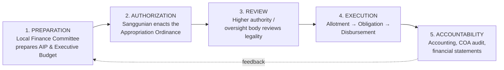
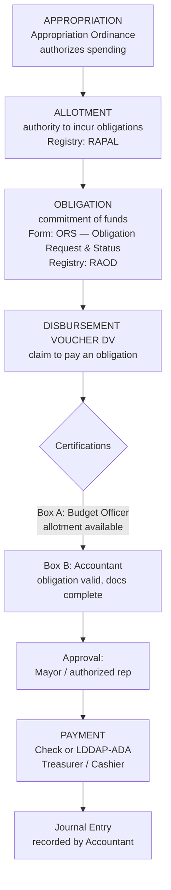
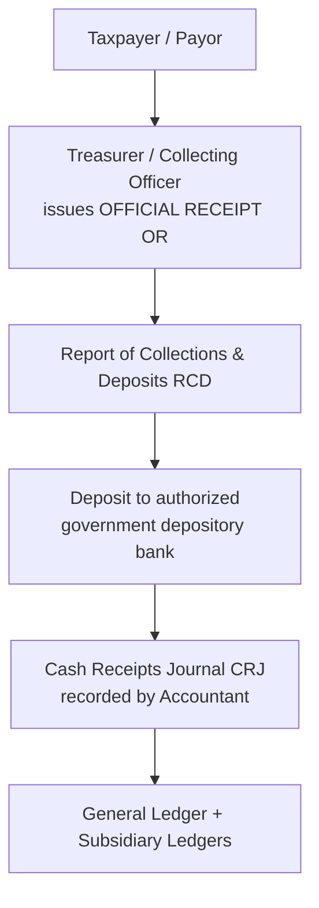

# Philippine LGU Accounting — Process & Compliance Reference

> Research reference for the Government Accounting System.
> Sources: COA Government Accounting Manual (GAM) for LGUs (COA Circular No. 2020-004), COA Circular 2015-009
> (Revised Chart of Accounts), RA 7160 (Local Government Code), DBM Budget
> Operations Manual for LGUs. See **Sources** at the bottom.

---

## 1. Legal & regulatory framework

| Authority | What it governs |
|---|---|
| **RA 7160** — Local Government Code of 1991 | LGU fiscal administration, budget process, treasury, the rule that *no money is paid out except via an appropriation ordinance* (Sec. 305) |
| **COA Circular 2015-009** (1 Dec 2015) — Revised Chart of Accounts for **LGUs** | Replaced the old 3-digit NGAS codes with **8-digit account codes**; accrual basis under PPSAS. **Superseded by 2020-004**, which carries the chart in Volume III |
| **GAM for LGUs** — **COA Circular No. 2020-004** (31 Jan 2020) | The current operating manual, in three volumes: I Accounting Policies, II Accounting Books, Registries, Records, Forms and Reports, III The Chart of Accounts. Supersedes the NGAS for LGUs (COA Circular 2002-003) and COA Circular 2015-009 |
| **PPSAS** — Philippine Public Sector Accounting Standards | Accrual accounting standards (IPSAS-based) |
| **DBM Budget Operations Manual for LGUs (BOM)** | The 5-phase LGU budget process |

> ⚠️ **Key point for this project:** "NGAS / COA Circular 2002-002" is **superseded**.
> The current compliant baseline is the **8-digit Revised Chart of Accounts + PPSAS**
> under the GAM for LGUs.

---

## 2. Fund structure (LGU accounting is FUND-BASED)

Every transaction, budget line, and report belongs to a **fund**. This is mandatory.

| Fund | Code | Purpose |
|---|---|---|
| **General Fund (GF)** | 01 | Day-to-day operations, the bulk of the budget |
| **Special Education Fund (SEF)** | 02 | Funded by the additional 1% real-property tax; for public school needs (via Local School Board) |
| **Trust Fund (TF)** | 03 | Money held for a specific purpose / received from other entities (e.g. grants, bonds, intergovernmental transfers) |

**Statutory sub-funds carved out of the General Fund:**
- **20% Development Fund** — 20% of the IRA/NTA for development projects
- **LDRRMF** — Local Disaster Risk Reduction & Management Fund (5% calamity fund)
- **GAD** — Gender and Development (≥5% of total budget)

---

## 3. The 5-phase LGU budget process (RA 7160 + DBM BOM)

**Officials involved:**
| Officer | Role |
|---|---|
| Local Chief Executive (**Mayor**) | Prepares & approves the executive budget; approves DVs |
| **Legislative body** | Enacts the Appropriation Ordinance |
| Local **Budget Officer** | Maintains registries; certifies allotment availability (ORS Box A) |
| Local **Accountant** | Maintains books; certifies obligation/charges (ORS Box B); records all entries |
| Local **Treasurer** | Collects revenue; certifies cash availability; disburses/pays |
| **COA** Resident Auditor | Post-audit; read-only oversight |

---

## 4. Budget EXECUTION chain (the core accounting flow)

**Expense classes** (allotments & obligations are tracked per class):
- **PS** — Personal Services (salaries, benefits)
- **MOOE** — Maintenance & Other Operating Expenses
- **FE** — Financial Expenses (interest, bank charges)
- **CO** — Capital Outlay (assets, infrastructure)

---

## 5. Revenue / collection flow

**Key revenue documents:** Official Receipt (OR), Report of Collections and Deposits (RCD), Real Property Tax Account Register, General/Special Collection Registers.

**Revenue sources:** Real Property Tax (basic + SEF 1%), Business Tax, fees & charges, the **National Tax Allotment (NTA)** — formerly IRA, share from national taxes.

---

## 6. Disbursement deductions (mandatory)

Every payroll/supplier DV withholds, then remits to the agency:

| Deduction | Remitted to |
|---|---|
| **Withholding Tax** (Expanded / Compensation) | **BIR** |
| **GSIS** (premiums, loans) | Government Service Insurance System |
| **PhilHealth** | PhilHealth |
| **Pag-IBIG / HDMF** | Home Development Mutual Fund |

---

## 7. Books of accounts

| Book | Code | Maintained by | Purpose |
|---|---|---|---|
| General Journal | GJ | Accountant | Adjusting, closing, non-cash entries |
| Cash Receipts Journal | CRJ | Accountant | All collections |
| Cash Disbursements Journal | CDJ | Accountant | Cash/ADA payments |
| Check Disbursements Journal | CkDJ | Accountant | Check payments |
| General Ledger | GL | Accountant | Summary by account |
| Subsidiary Ledgers | SL | Accountant | Detail per account/payee |

**Budgetary registries** (maintained by Budget Office, *not* part of double-entry books):
- **RAPAL** — Registry of Appropriations and Allotments
- **RAOD** — Registry of Allotments, Obligations and Disbursements (one per expense class: RAOD-PS, RAOD-MOOE, RAOD-FE, RAOD-CO)
- **ORS** — Obligation Request and Status (per obligation)

---

## 8. Required financial statements (GPFS under GAM)

A complete set = **six** statements, prepared **per fund** and consolidated:

1. **Statement of Financial Position** (SFP) — balance sheet
2. **Statement of Financial Performance** — income & expenses
3. **Statement of Changes in Net Assets / Equity**
4. **Statement of Cash Flows**
5. **Statement of Comparison of Budget and Actual Amounts (SCBAA)** — *unique & critical for LGUs; ties budget to actuals*
6. **Notes to Financial Statements** (incl. summary of accounting policies)

---

## 9. The 8-digit Revised Chart of Accounts (RCA)

For LGUs the 8-digit chart came in with COA Circular 2015-009 and now lives in
GAM for LGUs Volume III (COA Circular No. 2020-004). Top-level groups:

| 1st digit | Account group |
|---|---|
| **1** | Assets |
| **2** | Liabilities |
| **3** | Equity / Net Assets-Equity |
| **4** | Income |
| **5** | Expenses |

The remaining digits encode major group → sub-major group → GL account → contra/SL.
Example format used in this project: `1-07-03-010` (PPE), `4-01-01-010` (RPT-Basic).

---

## Sources

- [Government Accounting Manual (GAM) for LGUs — Vol. I, Accounting Policies (COA)](https://www.coa.gov.ph/download/2138/government-accounting-manual-gam-for-local-government-units/28015/volume-i-the-accounting-policies.pdf)
- [GAM for LGUs — Vol. III, The Chart of Accounts (COA)](https://www.coa.gov.ph/download/2138/government-accounting-manual-gam-for-local-government-units/28017/volume-iii-the-chart-of-accounts.pdf)
- [Annex A — List of the Revised Chart of Accounts, Local Governments (COA)](https://coa.gov.ph/wp-content/uploads/wpfd/preview_files/annex_a_charts_of_account(beb55539c682e39bb0f9df25ff161395).pdf)
- [The Revised Chart of Accounts and the Philippine Public Sector (PAGBA)](https://pagba.com/wp-content/uploads/2014/09/Revised-Chart-of-Accounts.pdf)
- [RA 7160 — Local Government Code of 1991 (LawPhil)](https://lawphil.net/statutes/repacts/ra1991/ra_7160_1991.html)
- [DBM Local Budget Circular No. 156](https://www.dbm.gov.ph/wp-content/uploads/Issuances/2024/Local-Budget-Circular/LOCAL-BUDGET-CIRCULAR-NO-156.pdf)
- [Instructions — Disbursement Voucher (BLGF)](https://blgf.gov.ph/wp-content/uploads/2016/01/Instructions-Disbursement-Voucher.pdf)
- [Obligation Request and Status (ORS) Guide](https://www.scribd.com/document/369857724/Appendix-11-Instructions-ORS-doc)
- [Ebudget System and eNGAS: Lived Experiences of Finance Officers (IJFMR)](https://www.ijfmr.com/papers/2024/3/23157.pdf)
- [Government Budget Process in the Philippines (Alburo Law)](https://www.alburolaw.com/government-budget-process-in-the-philippines/)

